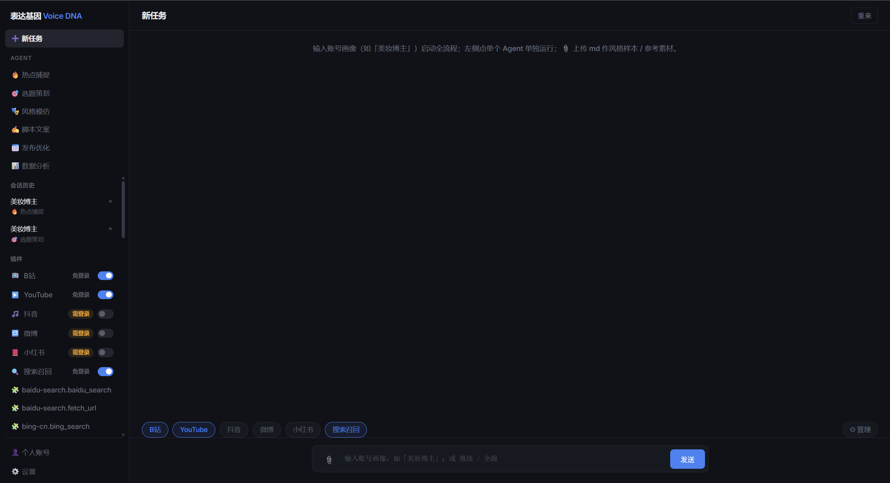
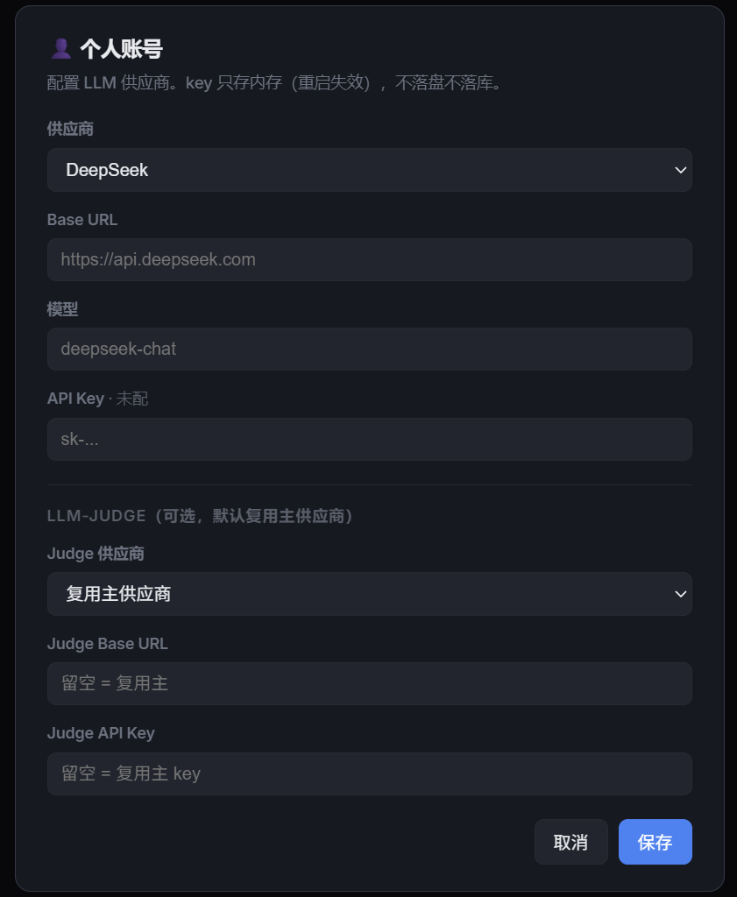
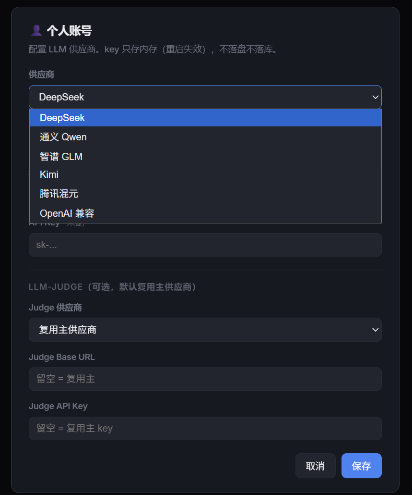

# 表达基因（Voice DNA）


> 多 Agent 社媒内容流水线：从热点捕捉到成片脚本，贯穿「风格模仿」题眼，接真实数据源，内置五门安全网关 + 五门质量门 + LLM-judge 防幻觉，并支持视频转录素材二次回流生成 v2 版本。

## 它解决什么

LLM 写社媒脚本最痛的是**编造**——没有可溯源素材，模型会瞎编具体数字 / 品牌 / 型号。表达基因把「内容理解 → 标注标准 → Prompt 撰写 → 数据分析 → 评测规则」这串能力落成一条可跑、可测、可扩展的 Agent 流水线，并用两条腿压住幻觉：

1. **接真实数据源**：bilibili / YouTube / 抖音 / 微博 + 搜索召回，把真实热点喂给 LLM。
2. **可溯源素材回流**：把热点视频转录成逐字稿，作为「有据可依」的素材喂回脚本写作，`data_analyst` 出 v1 vs v2 结构化对照。

题眼是**风格模仿**（`style_mimic`），从博主文案抽结构化「表达 DNA」（7 字段风格卡），其余 Agent 围绕它运转。

## 架构

```
用户输入账号画像
      │
      ▼
trend_hunter ──► topic_planner ──► style_mimic ──► script_writer
（热点猎人）      （选题策划）        （风格模仿⭐）      （脚本文案）
                                                        │
                                          ┌─────────────┤
                                          │  脚本质量门  │
                                          └─────┬───────┘
                                   PASS          │ HALT
                                          publish_optimizer ──► human_gate
                                          （发布优化）             （人工兜底）
                                          │
                                          │  data_analyst（数据分析）
                                          │       │
                                          │  ┌────┴─────┐
                                          │  │ 分析质量门 │
                                          │  └────┬─────┘
                                          │  PASS │ HALT
                                          END ◄───┴──► human_gate

全程两层门禁：
  安全网关 G1–G5（白名单 / 动作 / 风险 / 预算 / 审计 HMAC）——管「能不能调工具」
  质量门 5 门（schema / 非空长度 / 溯源 / 赛道相关 / 合规）——管「产出行不行」

后置增强（END 后，调用层驱动）：
  候选视频 → video_download → 抽音轨 → transcribe → transcripts
      → 二次跑 v2_app → data_analyst 出 v1 vs v2 对照（变化/更好/被验证/未变）

甩链接模式：
  用户贴视频链接 → download → transcribe → video_vision 分镜卡 → v2_app 生成脚本
```

每个 Agent 走「**确定性主路径 + LLM 补充 + LLM 兜底**」三段式：主路径免费、快、不幻觉；LLM 只在无 baseline 时兜底，编造内容被溯源门（LLM-judge）HALT 拦截走人工兜底。全局三档 LLM 参与度（确定性 / 兜底 / 全开）+ 每 Agent 独立开关。

## 平台支持

| 平台 | 数据源 | 状态 |
|---|---|---|
| B站 | keyless API（`/x/web-interface/popular`） | ✅ 真数据 |
| YouTube | `/feed/trending` 页面 `ytInitialData` | ✅ 真实现（海外网络） |
| 抖音 / 微博 | 登录态源（cookie，手动贴 + playwright 自动扫码） | ✅ cookie 登录 |
| baidu / bing | 检索源（stdio `npx baidu-search-mcp` / `bing-cn-mcp`） | ✅ 关键词召回 |

各平台数据源高度异构，差异化抓取与解析，收敛到统一 `TrendItem` 接口：

- **B站**：keyless API，请求不带浏览器 UA 会被直接 412，需伪造 UA。
- **YouTube**：抓 `/feed/trending` 内嵌 `ytInitialData`，递归遍历渲染器树定位内容项（依赖海外网络）。
- **抖音 / 微博**：需登录态，cookie 只落 `~/.voice-dna/cookies.json`；缺失时优雅返回空不阻断其余源。
- **检索源**：经 MCP `StdioTransport` 走 `npx` 子进程，无自写爬虫；`heat × 时间衰减` 排序 + `difflib` 相似度去重。

> 加新平台只需继承 `Scraper` 并设 `name`，注册表 `_SCRAPERS` 经 `__subclasses__` 自动发现。

## 六 Agent + 辅助

| Agent | 职责 | 输出 |
|---|---|---|
| `trend_hunter` 热点猎人 | 抓平台热点 + 关键词召回 + 记代表性视频 | `trends[]` + `candidate_videos[]` |
| `topic_planner` 选题策划 | 4 因子加权打分 | `topics[{title,score,reason}]` |
| `style_mimic` 风格模仿 ⭐ | 抽表达 DNA（题眼） | `style_card`（persona/voice/catchphrases 等 7 字段） |
| `script_writer` 脚本文案 | 分镜脚本（可溯源素材 + transcripts） | `{body, scenes[], duration}` |
| `publish_optimizer` 发布优化 | 平台/时间/标签 | `{platform, best_time, tags...}` |
| `data_analyst` 数据分析 | 对比基准 + 异常检测 + v1/v2 对照 | `{report, metrics, benchmark, anomalies, comparison}` |

辅助 Agent：

- **Concierge**：常驻对话栏，只读向导 + 启动判意（答疑 / 指引 / 唯一动作 `start_pipeline`），白名单只读 + 单动作，不参与调度。
- **LLM-judge**：质量门评判，结构化打分 `{score, pass, reason}`，默认复用主 provider、可选独立 provider 解耦。

每个 Agent 是一个 MCP tool，统一 JSON 进出，可独立替换实现、独立测试。

## 技术栈

| 层 | 选型 | 说明 |
|---|---|---|
| 编排 | **LangGraph**（自写 StateGraph） | 主图 7 节点 + 条件边 + `v2_app` 回流图；`interrupt_after` + Sqlite checkpointer 支持逐步执行 / 恢复 |
| 工具 | **FastMCP** | 6 Agent + transcribe/video_download/video_vision 注册 |
| 前端 | **Chainlit** + **FastAPI** + 静态 HTML/JS | 对话式 + 逐步执行双前端 |
| LLM | OpenAI 兼容 client | DeepSeek / Qwen / GLM / Kimi / 混元 / 自定义（下拉即切） |
| ASR | **funasr**（SenseVoiceSmall 本地） / DashScope（云端） | 本地默认免费，云端可选 |
| 视觉 | **Qwen-VL**（qwen3-vl-plus） | 抽帧 + 逐帧描述 → 分镜卡（`VOICEDNA_VISION` 成本门） |
| 存储 | **SQLite** | checkpoints（会话状态）+ sessions（会话列表） |

## 快速开始

```bash
# 1. 装依赖（Python 3.10+）
pip install -r requirements.txt

# 2.（可选）配置 LLM key，真调结构化抽取；不配则降级通用卡 / 确定性路径
#    Windows: set VOICEDNA_API_KEY=sk-xxx
#             set VOICEDNA_BASE_URL=https://api.deepseek.com
#             set VOICEDNA_MODEL=deepseek-chat
#    （也可起前端后在「个人账号」面板下拉选择供应商）

# 3.（可选）视频功能：ASR 本地需先起 funasr-server；视觉分镜需 set DASHSCOPE_API_KEY + set VOICEDNA_VISION=1

# 4. 跑测试
python -m pytest -q        # 221 passed

# 5. 起前端
chainlit run app.py                        # 对话式 http://localhost:8081
uvicorn web_server:server --port 8082      # 逐步执行 http://localhost:8082
```

前端输入账号画像（如「美妆博主」）跑六步流水线，每步中间产物可点开查看；数据源 chip 栏常驻可选，个人账号面板多供应商切换，候选视频可一键转录回流。

## 界面

**交互页** —— 左栏数据源列表 + 会话历史 + 个人账号，右栏六步流水线逐节点展示：

<div align="center">
  
</div>

**多供应商切换** —— 「个人账号」面板下拉即切 DeepSeek / Qwen / GLM / Kimi / 混元 / 自定义，key 只落内存不落盘：

<div align="center">
  
  
</div>

## 项目结构

```
.
├── README.md
├── app.py                      # Chainlit 对话前端
├── web_server.py               # FastAPI 逐步执行前端
├── chainlit.md                 # Chainlit 落地页
├── requirements.txt
├── static/index.html           # web 前端（chip 栏 / 个人账号面板 / 回流按钮）
├── plugins/
│   ├── sources.json            # 数据源能力声明
│   └── mcp_servers.json        # 外部 MCP server 注册
├── src/
│   ├── schemas.py              # SocialMediaState + 每 Agent 输出 schema
│   ├── llm.py                  # OpenAI 兼容 client（6 供应商）
│   ├── llm_mode.py             # LLM 参与度三档 + 每 Agent 开关
│   ├── agents.py               # 6 Agent 专家 persona
│   ├── config.py               # 供应商预设 + key 只落 os.environ
│   ├── cookies.py              # cookie 登录（V1 手动 / V2 playwright 扫码）
│   ├── concierge.py            # Concierge 对话向导
│   ├── session_store.py        # 会话列表
│   ├── mcp_server.py           # FastMCP server
│   ├── mcp_client.py           # call_tool + 安全网关热路径
│   ├── mcp_guard/              # 五门安全网关 G1–G5
│   ├── orchestrator/
│   │   ├── graph.py            # 主图 + v2_app 回流图
│   │   ├── quality_gate.py     # 五门质量门
│   │   └── judge.py            # LLM-judge
│   └── tools/
│       ├── trend_hunter.py / topic_planner.py / style_mimic.py
│       ├── script_writer.py / publish_optimizer.py / data_analyst.py
│       ├── transcribe.py       # ASR（funasr 本地 / DashScope 云端）
│       ├── video_download.py   # 视频下载（bilibili 直下 / douyin·xhs cookie）
│       └── video_vision.py     # 视觉分镜（抽帧 + Qwen-VL）
├── tests/                      # 221 测试
└── docs/
    ├── plans/                  # PLAN-P4 / PLAN-P5 / PLAN / PRD
    ├── handoffs/p4/            # HANDOFF-P4-*.md
    ├── handoffs/p5/            # HANDOFF-P5-*.md
    ├── images/                 # 界面截图（交互页 / 多供应商切换）
    ├── PROJECT-SUMMARY.md      # 项目全景总结
    └── RESUME.md               # 简历项目经历
```

## MCP 集成 + 安全网关

工具不直接 `import` 内部函数，而是注册在 FastMCP server 上，编排节点经 `call_tool` 走完整 MCP 协议，每次调用先过五门安全网关：

```python
# src/mcp_server.py — 注册
mcp = FastMCP("voice-dna")

@mcp.tool(name="style_mimic")
def _style_mimic(profile: str = "", topics=None, samples="", transcripts=None):
    return style_mimic.run(profile=profile, topics=topics or [], samples=samples, transcripts=transcripts or {})

# src/mcp_client.py — 调用（过 G1–G5 网关，未注册/越权返回 GuardDenied 而非崩）
async def call_tool(tool_name: str, **kwargs):
    decision = _guard.check(agent_id=tool_name, action=TOOL_ACTIONS.get(tool_name, "read"), ...)
    if not decision.allowed:
        raise GuardDenied(decision.gate, decision.reason)
    ...
```

好处：工具可独立替换、独立测试；换真实 MCP server（stdio 子进程）只改 `mcp_client` 一处、签名不变。

## 安全网关 + 质量门

**安全网关 G1–G5**（管工具能不能调）：

| 门 | 作用 |
|---|---|
| G1 工具门 | 白名单 = 本地 tool + 已注册外部 `server.tool`，未知拒绝 |
| G2 动作门 | `read` / `draft` / `external_write` 动作分类 |
| G3 风险门 | `external_write` 需人工批准；`read`/`draft` 放行 |
| G4 预算门 | 成本（token）+ 限流 + 重试上限 |
| G5 审计门 | 请求/响应/批准 JSONL 留痕 + HMAC |

**质量门 5 门**（管产出行不行，取最坏 `HALT > WARN > PASS`）：

1. **schema 硬门**（确定性）：字段必填 + 类型。
2. **非空 + 长度门**（确定性）：阈值校验。
3. **溯源门**（LLM-judge）：产出热点/数据必须可溯源到输入，编造 HALT。
4. **赛道相关门**（LLM-judge）：产出语义命中画像，跑题 HALT。
5. **合规门**（确定性词表）：广告法违禁词 / 虚假宣传词。

坚持「能确定性的不用 LLM」：主路径走规则 / 模板 / 统计，LLM 只做补充 + 兜底，显著降低推理成本并提升可测性。

## 测试

```bash
python -m pytest -q
# 221 passed
ruff check src tests          # 0 告警
mypy src web_server.py app.py # 0 告警（29 源文件）
```

覆盖：7 节点编排、六步线性跑通、MCP 真接往返、安全网关五门、质量门五门（含编造 HALT）、6 Agent 单元、3 视频工具、Concierge、LLM 参与度、v2 回流对照。真数据 E2E：视频下载 29MB → funasr 转录 755 字 → v2 回流 verdict「更好」。

## 商业落地

技术能力落地真实业务场景，验证 Agent 内容生产的商业闭环：

- 用 `style_mimic` 抽取淘宝 12 条真实标题的表达 DNA，复用变体至拼多多、闲鱼、京东等五平台，产出含标题公式、定价锚点、客服话术的网店模仿策略。
- 再次调用 DeepSeek 生成小红书 3 篇引流笔记与 6 场景评论话术，支撑副业冷启动。

## License

[MIT](LICENSE)
